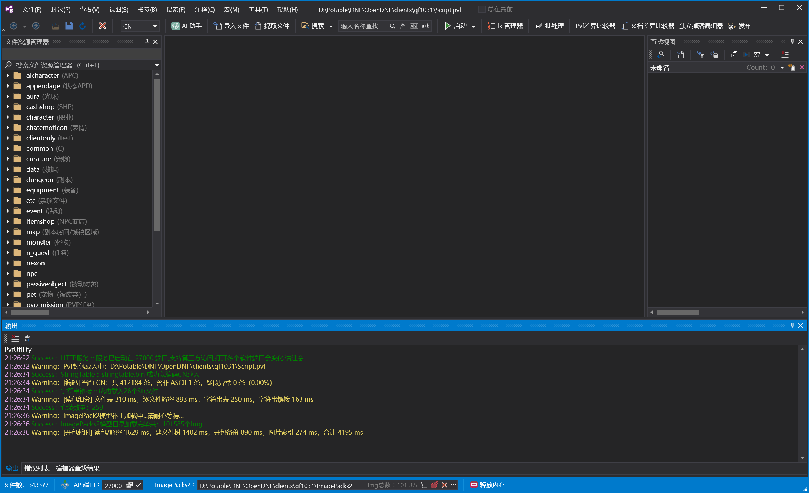

# pvfUtility

一个用来**查看和修改 DNF 客户端 PVF 封包**的 Windows 工具。

不用记命令行、不用手写二进制、不用先解包再打包——打开就能看到文件树、脚本、图标和实时预览，改完直接保存。



---

## 这是什么

DNF 客户端的道具、装备、技能、地图、NPC、时装，全部打包在一个 `.pvf` 文件里（常见名字是 `Script.pvf`）。

这个文件是**二进制格式**，游戏之外的工具很难直接读。想知道"这把剑的属性是怎么配的"，通常只能靠解包工具导出成一堆 txt，改完再打回去——中间任何一步出错，整个包就可能打不开。

pvfUtility 把这一整套流程做进了一个界面：

- **左边**是文件树，像资源管理器一样浏览包里几十万个文件
- **中间**是脚本编辑器，带标签高亮
- 打开文件后，**右侧**会显示对应的预览面板——改一个数字，装备面板立刻跟着变

---

## 主要功能

### 看得见：浏览与预览

- **文件树**：按目录展开，支持中文注释（比如 `equipment(装备)`），一眼知道每个目录是干什么的
- **脚本编辑器**：标签高亮、自动缩进，长脚本也不卡
- **装备 / 道具预览**：不用进游戏，直接看到名称、稀有度、攻击力、套装效果
- **ANI 动画预览**：时装、特效的动作可以直接播放
- **图标**：从客户端 `ImagePacks2` 里取真实图标，列表里直接显示

### 改得动：编辑与保存

- 直接改脚本内容，**保存即生效**，不需要额外的打包步骤
- 支持**批量导入 / 提取**：把整个目录导出成文件，或者把改好的文件导回去
- **lst 管理器**：管理 `.lst` 索引文件，不用手写编号
- **独立掉落编辑器**：改掉落表和概率，不用记字段位置

### 找得到：搜索

- 按**道具名 / 文件名**搜索，支持正则、全字匹配、前缀匹配
- 按**字符串引用**搜索：找出"哪些文件引用了这条文本"
- 按**数值**搜索：比如"哪个文件里有 12345 这个数"
- 搜索结果可以**另存为 txt**，或者导入回来做二次筛选

### 对得上：版本对比

- **PVF 差异比较器**：两个版本的包放一起，直接看哪些文件新增、删除、改动
- **文档差异比较器**：单看两个脚本的内容差异，按行对比
- 做补丁、查"官方这版改了什么"，这是最快的方式

### 体检：资源完整性

导入 ImagePacks2 和 PVF 之后，工具会自动做两项检查，结果写到 `Options\资源检查\`。

**一、同一路径被多个 NPK 提供**

DNF 客户端里常见同一个图片路径出现在多个 NPK 中。工具用 NPK 索引里记录的**字节长度**判断两边是不是同一份内容：

| 情况 | 含义 | 怎么处理 |
| --- | --- | --- |
| 字节长度不同 | 两个包里是**不同的文件**，属于覆盖关系 | 不能删任何一方；改的时候两个包都要改 |
| 字节长度相同 | 很可能是同一张图被重复打包 | 疑似冗余，**但删除前必须进游戏实测** |

**为什么不直接告诉你"能删"**：用小补丁包覆盖官方资源是常见做法。即使两边内容完全相同，删掉小包后加载顺序变化，表现仍可能改变。工具只陈述事实，删不删由你决定。

**二、PVF 引用了但 ImagePacks2 里找不到**

从 PVF 各脚本里提取 `.img` 引用，归一化后到图片索引里查，列出找不到的路径。游戏里通常表现为**白框、缺图或图标空白**。

识别规则决定了结果的可信度，这里说清楚：

- **只认 `.img` 结尾**。`.ani` 是 PVF 内部的动画定义（如 `%s/Attack1.ani`）、`.ogg` 在 `SoundPacks`、`.pvf` 是包文件——它们都不在 ImagePacks2 里
- **排除含 `%` 的模板**。像 `fm_body%04d.img` 里的 `%04d` 会被替换成帧号，不是真实文件名
- **归一化**：`\` 转 `/`、转小写、补 `sprite/` 前缀。PVF 里常写 `Map/xxx.img`，而 ImagePacks2 索引里是 `sprite/map/xxx.img`

**已知局限**（这些限制会影响结果，请结合实际情况判断）：

- 路径识别是**启发式**的：判断"像不像资源路径"靠特征匹配，不等于"一定是"。缺失清单需要人工抽查，不能当作权威结论
- 只覆盖直接写在节值里的字符串；通过字符串链接（`n_string.lst` 分组查表）间接引用的路径不在范围内
- 只比对图片资源，声音等其他类型不在范围内
- 结果受**文本编码**影响：编码选错会导致路径变乱码、全部匹配失败。检查前先确认日志里 `[编码]` 那行的异常率接近 0%

**输出文件**

```
Options\资源检查\
├── 冲突报告-<时间>.md       NPK 之间的重复与重叠（人读）
├── 冲突报告-<时间>.json
├── 缺失检查-<时间>.md       PVF 引用 vs ImagePacks2（人读）
└── 缺失检查-<时间>.json
```

JSON 里的 `relationship` 字段用固定英文码，便于外部脚本处理：

| 取值 | 含义 |
| --- | --- |
| `cover` | 小包是覆盖补丁（内容不同），不能删 |
| `possibleCopy` | 小包可能是纯副本，仍需实测确认 |
| `partialOverlap` | 两个包各有独有资源，都不能删 |

### 顺手的小东西

- **书签**：常改的文件钉在书签栏，不用每次翻目录
- **标签注释**：给 `[attack info]` 这类标签加自己的说明，鼠标悬停就能看
- **AI 助手**：可以让 AI 帮你查标签含义（需要自己配 API，默认关闭）
- **HTTP 服务**：开着工具时，其他程序可以通过本地端口读数据

---

## 有多快

用真实的台服客户端包测（212 MB，36 万个文件、75 万条字符串）：

| 操作 | 早期版本 | 现在 |
|---|---|---|
| 打开 PVF 到文件树可用 | 约 12 秒 | **4.4 秒** |
| 加载 ImagePacks2 图标索引（15 万张图） | 12 秒 | **不到 1 秒** |
| 在编辑器里连续打字时的预览刷新 | 每敲一个字重建一次 | 停手 0.12 秒后刷新一次 |

国服的包（41 万条字符串）更快：**3.6 秒**。

这些数字不是跑分，是打开软件时日志里直接写出来的：

```
[开包耗时] 读包/解密 2140 ms，建文件树 1804 ms，开包备份 438 ms，合计 4382 ms
```

---

## 不伤硬盘

PVF 的自动备份是"整包重写"——一个 212 MB 的包，每 5 分钟写一次，**挂机一天要写入约 30 GB**。对 SSD 来说是实打实的寿命消耗，而绝大多数时候你根本没改任何东西。

现在的做法：**备份前先比对内容指纹**。内容没变就完全跳过，一次都不写。

| 场景 | 早期版本 | 现在 |
|---|---|---|
| 开着 PVF 挂机 12 小时（没改东西） | 约 30 GB 写入 | **0** |
| 改了东西等一次备份 | 212 MB | 212 MB（该写还是写） |

配置文件也一样：`AppConfig.json` 有 4.7 MB，原来每次操作都整份重写，现在内容没变就跳过。

备份间隔默认 **10 分钟**，可以在「公共设置 → 自动备份」里改，也能直接关掉。

---

## 上手

### 1. 运行

下载后解压，双击 `pvfUtility.exe`。

**不要放在 `C:\Program Files`**——程序要往自己所在的目录写配置，那个目录没有写权限。

### 2. 打开 PVF

工具栏点 **「打开封包...(O)」**，选中客户端里的 `Script.pvf`。

第一次打开会慢一些（要把整个包读进内存），之后再打开会快很多。

### 3. 配图标（可选，但强烈建议）

主窗口**底部状态栏**有个路径输入框：

- 把客户端 `ImagePacks2` 文件夹的路径粘进去，或点右边的文件夹按钮选
- 中间的按钮是"刷新"，粉色的按钮是"清除"

配好之后，文件列表里会显示真实图标，装备预览里也能看到外观。

### 4. 改点什么试试

在左边的树里展开 `equipment`，随便点开一个文件：

- 中间改数字，右边预览会跟着变
- 改完按 `Ctrl+S` 保存
- 想确认效果？关掉软件重开，看改的内容还在不在

---

## 常见问题

### 打开后道具名全是乱码

不同服务器的客户端用的文字编码不一样：

| 服务器 | 该选的编码 |
|---|---|
| 台服 | `TW`（繁体，Big5） |
| 国服 | `CN`（简体，GBK） |
| 韩服 | `KR` |
| 日服 | `JP` |
| 欧美服 / 改过的包 | `UTF8` 或 `Unicode` |

去「公共设置 → 默认编码」里换一个，**重开 PVF** 就好。

打开包时日志会写一行解析质量，可以拿来判断：

```
[编码] 当前 TW：共 750905 条，含非 ASCII 202441 条，疑似异常 0 条（0.00%）
```

**异常率接近 0% 说明编码是对的**。如果是 5% 以上，就是选错了。

> 注意：切换编码不只是"换个显示方式"，它会按新编码重新编码字符串表。**只是想看看的话，改完别保存。**

### 图标全是空白

三种可能：

1. **没配 ImagePacks2** —— 回上面第 3 步
2. **路径配错了** —— 要选 `ImagePacks2` 这个文件夹，不是选客户端根目录
3. **客户端版本不匹配** —— 图标是按包里的相对路径去 `ImagePacks2` 里找的，换了客户端要重新配

### 文件树里少了文件 / 名字不对

先确认编码设置对不对（见上面第一条）。文件名本身固定用韩文编码（CP949）存储，这是 PVF 格式的约定，跟文本编码无关。

### 软件打不开 / 一闪就没了

- 确认系统是 Windows 10 1607 或更高、64 位
- 看 `%LOCALAPPDATA%\pvfUtility\logs\` 里有没有 `unhandled-*.log`，有的话把内容发出来
- 界面底部「输出」页签也会记录运行日志

### 保存后游戏里没变化

检查保存的是不是游戏实际读取的那个包。很多人的客户端里有两份 PVF（一份原版、一份改过的），改错了就看不到效果。

---

## 技术说明

想了解实现细节、构建方式、源码结构，见：

- **[docs/DEVELOPMENT.md](docs/DEVELOPMENT.md)** —— 完整的技术文档（构建、测试、项目结构、WPF 资源策略）
- **[docs/AI_ASSISTANT.md](docs/AI_ASSISTANT.md)** —— AI 助手的接口、权限边界与知识来源

几个关键事实：

| 项 | 说明 |
|---|---|
| 运行时 | .NET 10，自包含单文件，**不需要预先安装 .NET** |
| 系统要求 | Windows 10 1607+ / 64 位 |
| 分发形态 | `pvfUtility.exe` + `Options`、`Defaults`、`Resources` 三个目录，**必须整个文件夹一起用** |
| 配置文件 | `Options/AppConfig.json` 等，纯 JSON，可以直接编辑 |
| 联网 | 默认完全离线；只有你主动配置并启用 AI 助手时才会联网 |

---

## 来源与许可

本工具基于已发布程序的二进制恢复而来，不代表能够证明或恢复原始源码的版权、许可证和开发历史。

项目内包含 DevExpress 等第三方商业组件的二进制或恢复代码。**使用、修改或再分发前，请分别确认原程序和所有第三方组件的授权条件**——源码恢复本身不会产生额外的再分发权利。

原程序的账号、云备份、联网商店、自动更新、异常遥测等功能已停用，程序默认不联网。
